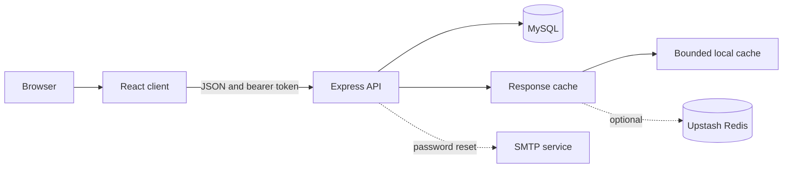
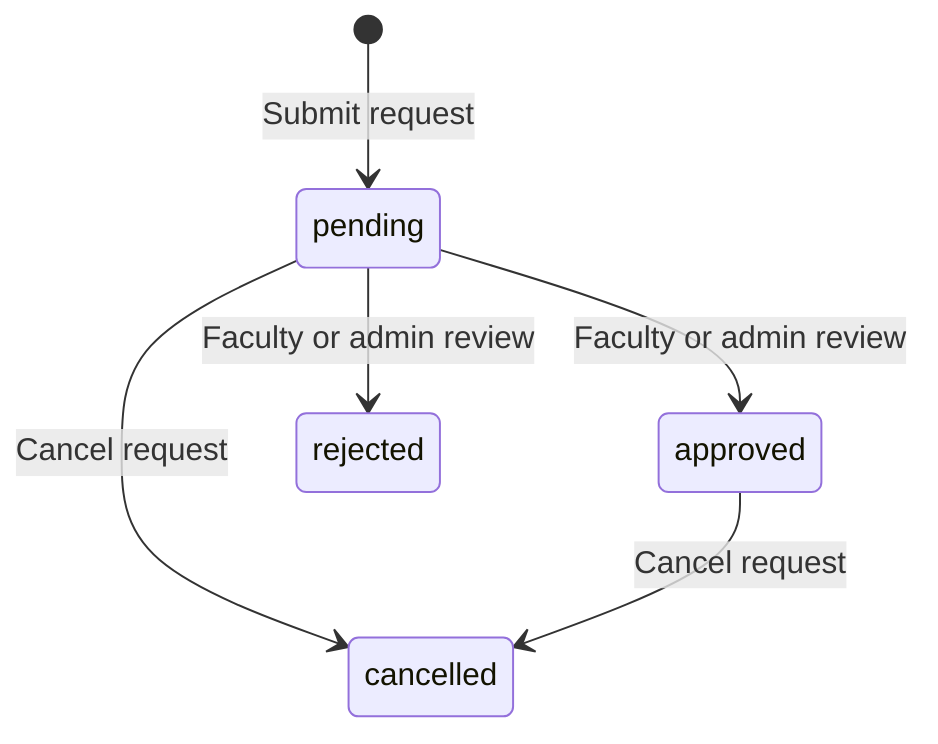

<div align="center">

# Faculty Resource Reservation

### A shared place to find, request, and manage campus resources

**React 18 · Express 4 · MySQL · JWT · Optional Redis**

[Quick start](#quick-start) · [Architecture](#architecture) · [API guide](#api-guide) · [Requirements](docs/SRS.md) · [Maintenance review](docs/MAINTENANCE.md)

</div>

---

## Overview

Faculty Resource Reservation is a full-stack application for students, faculty, and administrators. Users browse classrooms, laboratories, equipment, halls, and other resources; submit a booking request; and track its status. Administrators manage the resource catalogue, users, and reservations. Help requests and feedback provide a separate support channel.

> **Development status:** The application builds successfully and includes focused backend regression tests. Booking integrity, session revocation, recovery privacy and schema consistency have been hardened. See [known limitations](#known-limitations) for remaining operational acceptance work. This repository does not claim a completed security audit or measured performance targets.

## What you can do

| Area | Capabilities |
| --- | --- |
| Accounts | Student/faculty registration, sign-in, profiles, password changes and reset links |
| Catalogue | Browse resources, filter by type/status/building, inspect images and check a time slot |
| Reservations | Create pending requests, view personal history, edit or cancel requests |
| Administration | Manage users/resources, review reservations, view dashboard statistics |
| Notifications | View in-app messages, mark personal messages as read and delete them |
| Support | Submit feedback, browse help content, submit guest or authenticated help requests |
| Presentation | Responsive pages, animated backgrounds, loading feedback and confirmation dialogs |

### Roles at a glance

| Capability | Guest | Student | Faculty | Admin |
| --- | :---: | :---: | :---: | :---: |
| Public pages and guest help submission | ✓ | ✓ | ✓ | ✓ |
| Authenticated catalogue and own bookings | - | ✓ | ✓ | ✓ |
| Change reservation status through the review API | - | - | ✓ | ✓ |
| Review/respond to help requests through the API | - | - | ✓ | ✓ |
| Manage catalogue, users and all reservations | - | - | - | ✓ |
| Review/respond to feedback through the API | - | - | - | ✓ |

Faculty/admin booking review is integrated into Reservations (`/booking-history`). The floating Help & Support button contains personal help/feedback history and replies, plus staff response tools. Faculty review is campus-wide; reviewers cannot approve their own bookings.

## Architecture



The frontend uses React Router 7, Vite, Lucide icons, custom CSS and OGL animation components. Booking times use **Asia/Colombo**, including database/API conversions and reviewer display. The backend uses Express, mysql2 connection pooling, bcryptjs and JWT authentication. Rate limits apply to API traffic, authentication, resets and sensitive writes.

Redis is optional. Without a configured Redis client, responses use an in-process cache capped at 500 entries. This is per-process storage; multiple server instances do not share it. Resource lists are cached for 300 seconds and the administrator reservation list for 120 seconds. Supported filters are included in cache keys, and relevant writes invalidate list variants.

## Quick start

### 1. Prepare the tools

Use Node.js 22.12 or newer, compatible with the lockfiles and a MySQL-compatible server. The repository uses separate npm projects in `client/` and `server/`; there is no root installation command. MySQL 8 is a suitable intended database environment, while the schema also contains compatibility comments for older MySQL/MariaDB releases. Validate your chosen engine before deployment.

### 2. Install the locked dependencies

Run from the repository root:

```powershell
npm --prefix server ci
npm --prefix client ci
```

### 3. Configure the backend

```powershell
Copy-Item server/.env.example server/.env
```

Edit `server/.env`. The server loads its environment relative to its working directory, so run backend commands from `server/`, or use `npm --prefix server` as shown below. Supply your database credentials and a strong unique `JWT_SECRET`. Keep this file private.

| Setting | Purpose | Default or behavior |
| --- | --- | --- |
| `PORT` | API listen port | `5000` |
| `NODE_ENV` | Runtime mode | Set `development` locally |
| `CLIENT_URL` | Allowed frontend origin and reset-link base | `http://localhost:3000` for local use |
| `DB_HOST`, `DB_USER`, `DB_PASSWORD`, `DB_NAME` | Database connection | Configure explicitly |
| `JWT_SECRET` | Signs and verifies access tokens | Replace the example value |
| `DB_POOL_MAX` | Maximum database connections | `20` |
| `DB_POOL_MIN` | Passed to mysql2 as `maxIdle` | `2`; this is an idle cap, not a minimum |
| `DB_POOL_IDLE_TIMEOUT` | Idle timeout in milliseconds | `30000` |
| `DB_CONNECT_TIMEOUT` | Connection timeout in milliseconds | `30000` |
| `CACHE_ENABLED` | Enables configured remote Redis | `false` still permits local caching |
| `UPSTASH_REDIS_REST_URL`, `UPSTASH_REDIS_REST_TOKEN` | Optional remote cache credentials | Required together for Redis |
| `SMTP_HOST`, `SMTP_PORT`, `SMTP_USER`, `SMTP_PASS`, `SMTP_FROM` | Password-reset delivery | Configure the system sender; see docs/EMAIL_SETUP.md for queued email delivery |

The frontend API base defaults to `http://localhost:5000/api` in development and `/api` in production. To override it, create `client/.env.local`:

```dotenv
VITE_API_URL=http://localhost:5000/api
```

Vite reads this at startup/build time. The previous `REACT_APP_API_URL` setting remains supported for compatibility. Rebuild after changing it. For same-origin production hosting, `VITE_API_URL=/api` is appropriate.

### 4. Set up the database

Start MySQL, configure `server/.env`, then run:

```powershell
npm --prefix server run db:setup
```

This creates the configured database if missing and applies the journaled canonical schema. Existing rows are preserved. Backend startup also applies pending migrations. For an existing database, take a backup first and use `npm --prefix server run migrate`. Fresh installs and upgrades use the same table/trigger definitions from `database/schema.sql`.

The runner takes a schema lock, checks missing columns/indexes, installs notification triggers and records its version in `schema_migrations`. Interrupted DDL can be retried. Historical SQL migrations and the old database dump are references, not the active upgrade path. Do not replay them or import a sample dump into an existing database.

### 5. Start both applications

Open two terminals from the repository root:

```powershell
# Terminal 1
npm --prefix server run dev
```

```powershell
# Terminal 2
npm --prefix client start
```

| Service | Address |
| --- | --- |
| Frontend | <http://localhost:3000> |
| API | <http://localhost:5000/api> |
| Health check | <http://localhost:5000/api/health> |

The health endpoint reports process availability. `/api/ready` separately checks database connectivity and returns 503 when unavailable.

### 6. Create your first administrator

Register your own account and ask a database operator to promote it using the provisioning command, or create an administrator with an operator-supplied password:

```powershell
$env:ADMIN_EMAIL = 'your-address@example.com'
$env:ADMIN_PASSWORD = 'your-own-strong-password-with-a-number'
npm --prefix server run create-admin
Remove-Item Env:ADMIN_PASSWORD

# For an already registered account, explicitly authorize promotion:
npm --prefix server run create-admin -- --promote
```

There are no hard-coded default credentials. To create development-only demo users and one resource, set `SEED_PASSWORD` and run `npm --prefix server run seed` with `NODE_ENV=development`. Existing accounts/passwords are not overwritten. Sign in again after promotion or a role change.

### Optional Windows launcher

```powershell
.\START_SERVERS.ps1
.\START_SERVERS.ps1 -Stop
```

The launcher leaves occupied ports alone, writes logs to `.runtime/` and stops only processes that it started and recorded. It does not kill unrelated Node applications.

## Working with bookings



New requests start as `pending`. Resource-specific automatic approval remains future scope. Reviewers can reopen requests, but resource availability, future timing and conflicts are rechecked transactionally before the request becomes active. Reviewers cannot approve their own requests. Timing changes to approved requests return them to pending for review.

Availability treats intervals as `[start, end)`: a booking ending at 10:00 can be followed by one starting at 10:00. Pending/approved requests block overlapping slots. All booking writes lock the resource row before checking/changing reservations, preventing concurrent conflicting requests from both being accepted. Owners use the cancellation action rather than submitting a status through the generic edit endpoint.

## API guide

Use `Authorization: Bearer <token>` for protected endpoints. Most responses use `{ success, data }` or `{ success: false, message }`; validation errors may include an `errors` array. This is an endpoint index, not a complete machine-readable API contract.

| Base | Endpoints | Access |
| --- | --- | --- |
| `/api/auth` | `POST /register`, `/login`, `/forgot-password`, `/reset-password` | Public, rate limited |
| `/api/auth` | `GET /verify`, `GET/PUT /profile`, `POST /change-password` | Authenticated |
| `/api/auth` | `GET/POST /users`, `PUT/DELETE /users/:id` | Admin |
| `/api/resources` | `GET /`, `/available`, `/popular`, `/:id`, `/:id/availability` | Authenticated |
| `/api/resources` | `GET /stats/summary`, `POST /`, `PUT/DELETE /:id` | Admin |
| `/api/reservations` | `GET /my-reservations`, `/upcoming`, `/stats`, `/by-date`, `/:id`; `POST /`; `PUT /:id`; `POST /:id/cancel` | Authenticated; owner checks vary by endpoint |
| `/api/reservations` | `PUT /:id/status` | Faculty/admin |
| `/api/reservations` | `GET /` | Faculty/admin |
| `/api/reservations` | `DELETE /:id` | Admin |
| `/api/notifications` | `GET /`, `PATCH /read-all`, `PATCH /:id/read`, `DELETE /:id` | Authenticated; personal writes |
| `/api/notifications` | `GET /all`, `POST /` | Admin |
| `/api/feedback` | `POST /`, `GET /my-feedback`, `GET /:id` | Authenticated; own history/details |
| `/api/feedback` | `GET /admin/all`, `PUT /admin/:id/respond` | Admin |
| `/api/help` | `POST /` | Guest email or verified signed-in account |
| `/api/help` | `GET /my-requests`, `GET /:id` | Authenticated; own history/details |
| `/api/help` | `GET /admin/all`, `PUT /admin/:id/respond`, `PATCH /admin/:id/status` | Faculty/admin |

Collection pagination uses `limit` (1–200) and `offset` (0–1000000). Core lists default to 100 rows. Existing complete-list screens fetch bounded batches; review/support queues display 20 items per page.

Resource list filters: `type`, `status`, `building`. Admin reservation list filters: `user_id`, `resource_id`, `status`, `date`. Availability requests use `start_time` and `end_time`.

## Repository map

```text
client/
  public/                  Public image assets
  index.html               Vite application entry
  vite.config.mjs          Development/build configuration
  src/
    assets/css/            Shared and page styles
    components/            Shared UI, headers, footer and dialogs
    config/api.js          Endpoint definitions and auth helpers
    hooks/                 Active UI effects and bootstrap hook
    pages/                 Public, student and admin pages
    utils/                 Fetch and section-cache helpers
server/
  src/
    config/                MySQL, cache and SMTP configuration
    controllers/           Request handling and business rules
    middleware/            Authentication, rate limits and caching
    models/                Parameterized database queries
    routes/                Express endpoint definitions
    utils/                 Stable filter cache keys
    server.js              API and static-client entry point
  tests/                   Regression tests and legacy/load utilities
database/                  Canonical schema and historical setup assets
docs/
  SRS.md                   Software requirements and acceptance criteria
  SRS.docx                 Editable Word requirements document
  MAINTENANCE.md           Cleanup record, validation and remaining issues
```

## Development and validation

```powershell
# Focused regression tests, isolated from external services
npm --prefix server test

# Database-backed acceptance checks against disposable databases
npm --prefix server run test:integration

# Frontend correctness checks
npm --prefix client run lint

# Production frontend bundle
npm --prefix client run build

# Run the API without the development watcher
npm --prefix server start
```

Eight focused tests cover caching, authentication state, production secrets, timestamp validation, pagination and optional help authentication. The database suite verifies fresh/legacy upgrades, concurrent bookings, cancellation/reactivation, schedule privacy, notifications/support, single-use recovery and revoked sessions. It creates and removes only randomly named `frr_verify_*` databases and requires database-creation permissions. It also reports a small-fixture concurrent-read smoke check; it does not certify production capacity.

Load-test definitions are in `server/tests/load/`. Their npm commands invoke Artillery through `npx`, so they may download tooling. Run them only against a disposable test environment; they are not evidence of achieved throughput. Email tests use isolated transports and never send to real recipients.

When `client/build/` exists, Express serves it and falls back to `index.html` for client routes. Set the frontend API URL before building. For a deployment, configure `NODE_ENV=production`, `CLIENT_URL`, database access, SMTP and the application secret, then validate the complete booking flow.

## Troubleshooting

| Symptom | Check |
| --- | --- |
| Database connection fails | Start MySQL, create the database, verify `server/.env` and run from `server/` |
| Unknown column errors | Compare the installed schema to `schema.sql` and runtime initialization; inspect migrations before applying |
| Catalogue returns 401 | Sign in; catalogue endpoints require a bearer token |
| Password-reset email does not arrive | Configure Gmail SMTP and restart the backend. Inspect email_outbox delivery status; see docs/EMAIL_SETUP.md |
| API request returns 429 | Observe rate-limit headers and wait for the relevant window |
| Production client calls localhost | Rebuild with the intended `VITE_API_URL` |
| Session expires after the upgrade | Sign in again; old-format tokens and revoked token versions are rejected |

## Known limitations

- Institutional working hours, advance-booking/duration limits and retention rules need agreed policy before enforcement. Recurring schedules, favourites, SSO and calendar synchronization remain outside the implemented workflow.
- Faculty review remains campus-wide. Resource-specific reviewer assignments are a future policy/feature decision.
- Configure production HTTPS, a unique secret of at least 32 characters, allowed frontend origin and working SMTP. Real SMTP delivery and deployment-specific operation must be verified in that environment.
- Full screen-reader acceptance, agreed production-scale load and a backup-restoration exercise remain to be completed. Local integrity/security checks do not replace them.
- Dependency audits report zero known vulnerabilities at verification time. Re-run audits as dependencies/advisories change. The build now uses Vite, with separate application and vendor chunks.

Passwords/role changes revoke previous sessions. Deleted/inactive accounts lose access on the next protected request. API responses omit SQL/stack detail in production. Reset responses do not reveal account existence; raw reset links are logged only through explicit local-development opt-in.

See the [maintenance review](docs/MAINTENANCE.md) for validation evidence and the [SRS](docs/SRS.docx) for requirements and acceptance criteria.

## Contributing

Keep changes focused, preserve existing uncommitted work, and use the canonical API configuration rather than hard-coded endpoint URLs. Add regression coverage for business-rule changes, run backend tests and the client build, and document schema changes with a reviewed upgrade path.

## License

No license file is present in this checkout. Confirm the project owner's intended license before reuse or redistribution.

---

<div align="center">

**Documentation refreshed 18 October 2026** · Implementation and requirements are documented separately

</div>

## Current fixes and operations

See [implemented fixes](docs/IMPLEMENTED_FIXES_2026-10-19.md) for registration permissions, registration IDs, review history, optional booking policy, guest tracking, transactional email, backup/restore and validation evidence.
